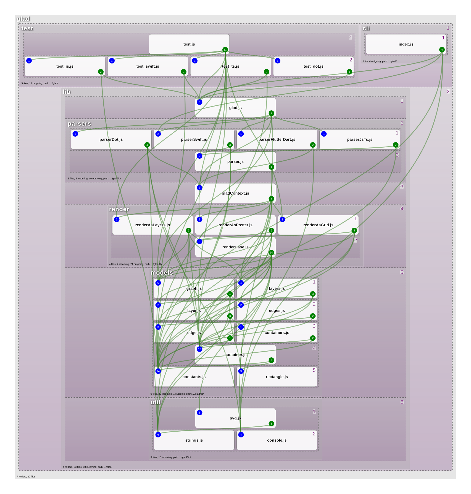

# GLAD - Generate Layer Architecture Diagram

Automatically generate **layer diagram** view of your source code dependencies.

Supports **JavaScript**, **TypeScript**, **Dart** (Flutter), **Swift**, and **DOT** graph files.

## Motivation

View and Keep your project source files layer dependencies clean. Avoid circular reference or referencing an upper layer from a lower layer.

### Project types supported

* **NodeJS** - source files of type **JS & TS**
* **Flutter/Dart** - package dependencies
* **Swift** - iOS/macOS projects using Tree-Sitter parsing
* **DOT** - GraphViz DOT file input for custom diagrams

Simply launch the ```glad``` command and open the resulting ```glad.svg``` file.

## Example



## Technologies used

[](https://nodejs.org/)
[](https://npmjs.org/)
[](https://en.wikipedia.org/wiki/JavaScript)
[](https://en.wikipedia.org/wiki/JSON)
[](https://ts-morph.com/)
[](https://en.wikipedia.org/wiki/Scalable_Vector_Graphics)
[](https://eslint.org/)
[](https://standardjs.com/)

## Features

* Optional grouping of layers by folders.
* Rendering views as Posters, Layers, or Grid.
* Render with or without edges connection lines.
* Orphan node detection - highlights files/folders with no dependencies.

## Installation

### Globally

```bash
npm install -g .
```

### DevDependencies

```bash
npm install -D @jpdup/glad
```

### As  part of your build script step

By adding "glad" to your build step, you will be alerted if you introduce a circular dependencies.

```JSon
{
  "scripts": {
    "build": "glad ."
}
}
```

### Exit Codes

`glad` returns explicit status codes so CI can fail on architecture issues:

* `0` success
* `2` invalid input (for example invalid or missing DOT file)
* `3` output write error
* `4` no files found to analyze
* `99` upward dependencies found
* `100` circular dependencies found

When both upward and circular dependencies are present, `100` is returned.

## Execute

```bash
glad
```

## CLI Help

```text
glad -h

Usage: glad < path | file.dot > [options]  "Generates an SVG layer diagram file based on your source code dependencies or DOT graph files"

Options:
  -h, --help              Show help  [boolean]
      --align             Set the horizontal position of the nodes  [string] [choices: "left", "center", "right"] [default: "center"]
      --debug             For tech support  [boolean] [default: false]
  -d, --details           Show additional values for each folders  [boolean] [default: false]
      --dev               Show Dev dependencies  [boolean] [default: false]
      --edges             Type of rendering for all edges  [string] [choices: "files", "folders"] [default: "files"]
  -e, --exclude           File glob patterns to exclude from the analysis, eg: "**/*.test.js" "**/AppLogger*"  [array]
      --externals, --ex   Show external dependencies  [boolean] [default: false]
  -i, --input             File path to scan  [string]
      --json              Output the graph to file called glad.json  [boolean] [default: false]
  -l, --layers            Display the layers background and numbers  [boolean] [default: false]
      --lineEffect, --le  Special effect on the lines  [string] [default: "flat"]
      --lines             Type of rendering for all edges  [string] [choices: "curve", "strait", "elbow", "angle", "hide", "warnings"] [default: "curve"]
      --listFiles         List all input files found  [boolean] [default: false]
      --orphans           List all orphan nodes (nodes with no edges)  [boolean] [default: false]
  -o, --output            File path to output svg  [string] [default: "./glad.svg"]
  -s, --silent            No output except for errors  [boolean] [default: false]
      --view              Type of diagram to generate  [string] [choices: "poster", "layers", "grid"] [default: "poster"]
  -v, --version           Show version number  [boolean]

Examples:
  glad . --view layers -l --edges -hide  ">>> Produce a diagram with no edges, each layers are numbered."
  glad myGraph.dot --view layers -l      ">>> Generate layers diagram from DOT graph file."

for more information visit https://github.com/amzn/generate-layer-architecture-diagram
```

## License

This project is licensed under the Apache-2.0 License.

[](https://www.apache.org/licenses/LICENSE-2.0)
